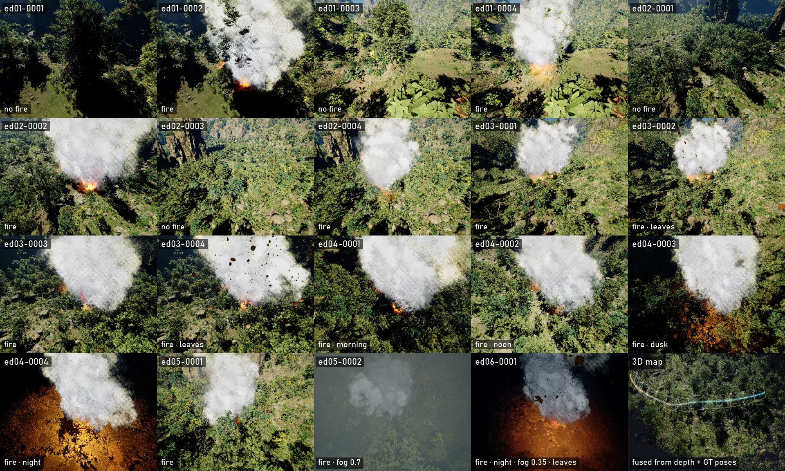
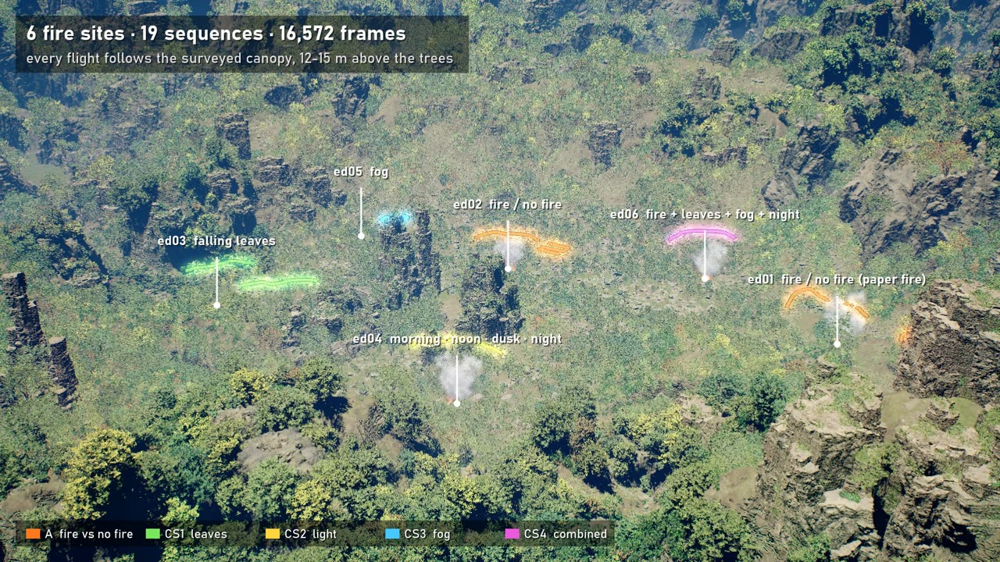
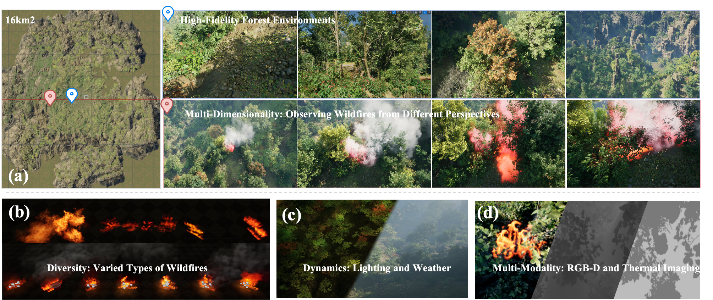
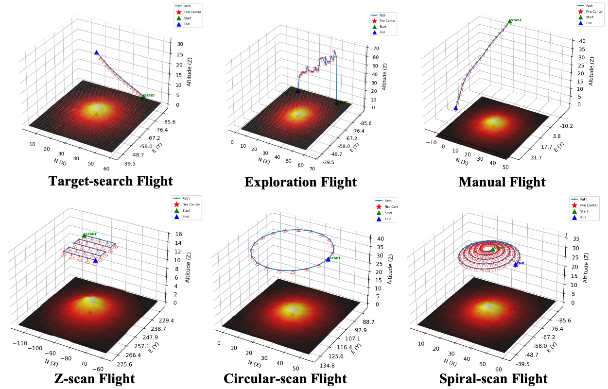

<p align="center">
  <h1 align="center">WildfireX-SLAM</h1>
</p>

<h3 align="center">A Low-altitude Multi-modal UAV Dataset and Simulator for Wildfire SLAM and Beyond</h3>

<p align="center">
  <a href="https://zhicongsun.github.io/"><strong>Zhicong Sun</strong></a><sup>1</sup>,
  <strong>Jacqueline Lo</strong><sup>1*</sup>,
  <strong>Jinxing Hu</strong><sup>2*</sup>
  <br>
  <sup>1</sup>Hong Kong Polytechnic University &nbsp; <sup>2</sup>Shenzhen Institutes of Advanced Technology, CAS &nbsp; (* corresponding authors)
</p>

<h3 align="center">
  <a href="https://zhicongsun.github.io/wildfirexslam"><strong>Project Page</strong></a>
  |
  <a href="https://arxiv.org/abs/2510.27133"><strong>Paper</strong></a>
  |
  <a href="https://huggingface.co/datasets/zhicongsun/WildfireX-SLAM"><strong>Dataset v2.0</strong></a>
  |
  <a href="https://docs.google.com/forms/d/e/1FAIpQLSffX-tsr1oIsin76nxWs4YAjIgf2QjCnUWJFvDR1EA6fIs2YA/viewform?usp=dialog"><strong>Dataset v1.0</strong></a>
  |
  <strong>Simulator (coming soon)</strong>
</h3>

<p align="center">
  
</p>
<p align="center">WildfireX-SLAM v2.0: one frame of each of the 19 sequences, and a 3D map fused from depth and ground-truth poses. <a href="https://zhicongsun.github.io/wildfirexslam">Video on the project page.</a></p>

## News

- **2026-10** — **WildfireX-SLAM v2.0**: 19 sequences over 6 fire sites, 7 pixel-aligned modalities with exact poses at 30 Hz,
  controllable fire, smoke, fog, falling leaves and time of day — plus the open `wildfirex` toolkit to collect your own data.
- 2026-01 — v1.0 dataset, including the Benchmark B data, available on request ([form](https://docs.google.com/forms/d/e/1FAIpQLSffX-tsr1oIsin76nxWs4YAjIgf2QjCnUWJFvDR1EA6fIs2YA/viewform?usp=dialog)).
- 2025-11 — v1.0 data-collection code released (now in [`legacy/v1/`](legacy/v1/)).
- 2025-10 — Paper accepted to MMM 2026 as an oral presentation; paper on [arXiv](https://arxiv.org/abs/2510.27133).

## WildfireX-SLAM v2.0

| | |
|---|---|
| Sequences | 19 (`<site>-<number>`, sites `ed01` … `ed06`) |
| Frames | 16,572 at 640×480, 30 Hz (≈ 58 GB) |
| Modalities | RGB, depth (cm, includes smoke), surface normal, albedo, roughness, specular, object-ID "infrared" — all from the same frame |
| Ground truth | camera-to-world poses (TUM + Replica formats), intrinsics, velocity / acceleration, fire positions, full scene settings |
| Flights | follow a surveyed canopy map 12–15 m above the trees (median 29–42 m above ground) |
| Conditions | fire on / off, falling leaves, fog, morning / noon / dusk / night — switched while flying exactly the same path |
| Simulator | WildfireX-Sim 1.1 (Unreal Engine 5.2 Electric Dreams, AirSim-based) |

| Benchmark | Sequences | Factor | Flight |
|---|---|---|---|
| A | ed01-0001…0004, ed02-0001…0004 | no fire vs. fire, two sites | spiral around the fire; lawn-mower survey beside it |
| CS1 | ed03-0001…0004 | falling leaves | search flight towards the fire; spiral |
| CS2 | ed04-0001…0004 | morning / noon / dusk / night | spiral |
| CS3 | ed05-0001, 0002 | fog (0 vs 0.7) | lawn-mower survey |
| CS4 | ed06-0001 | fire + leaves + fog (0.35) + night | spiral |

<p align="center"></p>
<p align="center">Six fire sites in the UE5 forest and the 19 canopy-following trajectories, coloured by benchmark.</p>

Download from [Hugging Face](https://huggingface.co/datasets/zhicongsun/WildfireX-SLAM) — one zip per modality per sequence,
so you can fetch e.g. only RGB-D (≈ 17.5 GB of ≈ 62 GB); see the dataset card — unzip in place and load a sequence:

```python
from wildfirex.io.sequence import Sequence          # pip install wildfirex
seq = Sequence("WildfireX-SLAM/sequences/ed01-0002")
rgb, depth, c2w, K = seq.rgb(0), seq.depth(0), seq.poses[0], seq.K   # depth in metres, OpenCV camera-to-world
```

**Conventions:** depth PNGs are in **centimetres** (`depth_scale: 100`, not TUM's 5000 — set your loader's depth scale to 100);
poses are camera-to-world with an OpenCV camera (x right, y down, z forward) in an AirSim NED world (x north, y east, **z down**).
Details and a z-up conversion: [docs/data_format.md](docs/data_format.md#conventions). Differences from v1.0: dataset card on Hugging Face.

## Collect your own data

The `wildfirex` toolkit (in [`src/wildfirex`](src/wildfirex)) drives the packaged simulator through AirSim, sets fire, light
and weather at runtime, flies the configured trajectories and writes every modality with exact poses and quality checks.
Every v2.0 sequence is regenerated by [`configs/wildfirex_slam_v2.yaml`](configs/wildfirex_slam_v2.yaml).

1. **Simulator** — WildfireX-Sim 1.1 for Windows 10/11 with a DirectX 12 GPU (no Unreal Editor needed). *Release coming soon*;
   see [simulator/](simulator/README.md).
2. **Toolkit** (Python ≥ 3.8): `pip install wildfirex`, or from this repository `pip install -e .`
3. Run:

```bash
set WILDFIREX_SIM=C:\WildfireX-Sim-1.1-Win64\ElectricDreamsSample.exe
wildfirex check-sim                                        # one RGB-D frame + timing
wildfirex collect configs/examples/quickstart.yaml         # a 150-frame test sequence, ~3 min

# reproduce WildfireX-SLAM v2.0
wildfirex survey  configs/wildfirex_slam_v2.yaml           # once: canopy surface map
wildfirex survey  configs/wildfirex_slam_v2.yaml --refine  # once: low-altitude re-survey around the fire sites
wildfirex collect configs/wildfirex_slam_v2.yaml           # all 19 sequences (resume-safe); --only ed05-0002 for one
```

For identical paths, skip the two survey steps and pass the canopy map shipped with the dataset:
`wildfirex collect configs/wildfirex_slam_v2.yaml --surface WildfireX-SLAM/survey/surface.npz`.

Write your own scenarios (sites, trajectories, fire, light, weather): [docs/config.md](docs/config.md).

## Repository

```
src/wildfirex/   toolkit (PyPI: wildfirex): simulator control, scene control, trajectories, capture, QA, loaders
configs/         dataset configs (wildfirex_slam_v2.yaml reproduces v2.0) and examples
docs/            configuration, data format, architecture, naming and versions
simulator/       simulator versions and AirSim integration notes (the binary is distributed separately)
benchmarks/      evaluation protocols and baselines (planned)
tools/           maintainer scripts (dataset staging)
legacy/v1/       v1.0 (MMM 2026) data-collection script, as published with the paper
images/          figures
```

## v1.0 (MMM 2026 paper)

*WildfireX-SLAM: A Large-scale Low-altitude RGB-D Dataset for Wildfire SLAM and Beyond* — 5.5k low-altitude RGB-D
aerial images over a 16 km² forest map, with benchmarks A and B. The data are available on request
([form](https://docs.google.com/forms/d/e/1FAIpQLSffX-tsr1oIsin76nxWs4YAjIgf2QjCnUWJFvDR1EA6fIs2YA/viewform?usp=dialog));
the original collection script is in [`legacy/v1/`](legacy/v1/) (git tag `v1.0`).

<details>
<summary>v1.0 figures</summary>
<p align="center"></p>
<p align="center">Overview of the WildfireX-SLAM v1.0 dataset.</p>
<p align="center"></p>
<p align="center">Diversity of the v1.0 dataset.</p>
<p align="center"></p>
<p align="center">Examples of v1.0 flight paths.</p>
</details>

## Citation

```bibtex
@inproceedings{sun2026wildfirex,
  title={WildfireX-SLAM: A Large-Scale Low-Altitude RGB-D Dataset for Wildfire SLAM and Beyond},
  author={Sun, Zhicong and Lo, Jacqueline and Hu, Jinxing},
  booktitle={International Conference on Multimedia Modeling},
  pages={533--546},
  year={2026},
  organization={Springer}
}
```

## Acknowledgement

This work incorporates and builds upon open-source projects. We thank the authors for their contributions.
- [AirSim](https://github.com/microsoft/AirSim)
- [Cosys-AirSim](https://github.com/Cosys-Lab/Cosys-AirSim)
- [ProjectAirSim](https://github.com/iamaisim/ProjectAirSim)
- [PromptCraft-Robotics](https://github.com/microsoft/PromptCraft-Robotics)
- [Airsim Agent](https://github.com/maris205/airsim_agent)

Third-party code and assets: [NOTICE.md](NOTICE.md).

## License

Code: MIT ([LICENSE](LICENSE)). Dataset: [WildfireX-SLAM Dataset License](DATASET_LICENSE.md) — the terms of CC BY 4.0 plus
one restriction: no use for generative AI (passed on from the "NoAI" terms of the Unreal Engine assets depicted).
The packaged simulator has its own terms. Unreal® is a trademark or registered trademark of Epic Games, Inc.
